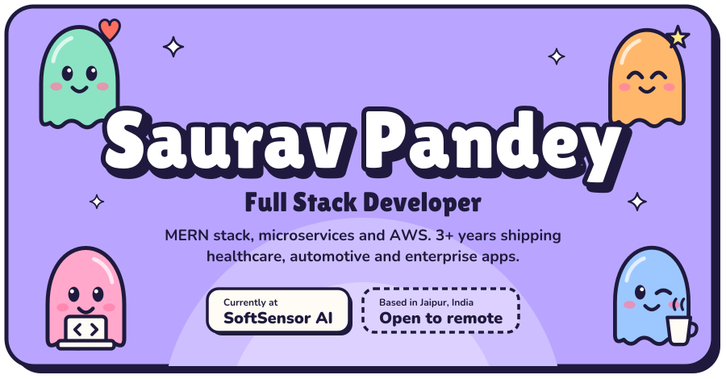
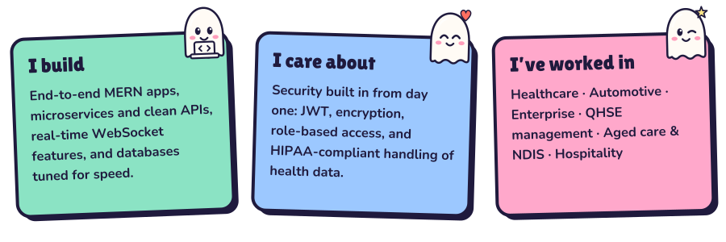
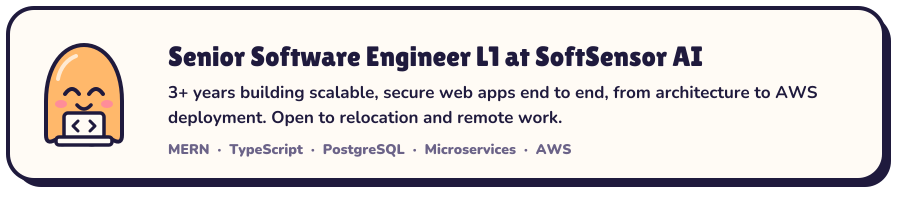
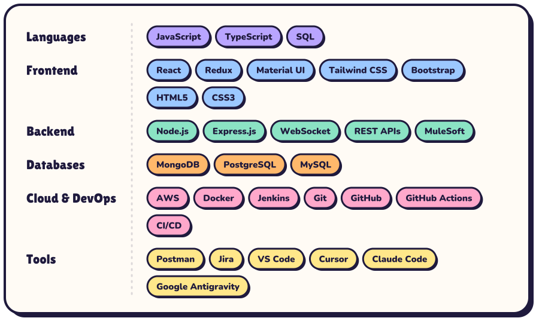
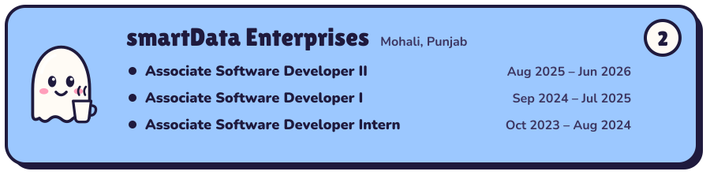
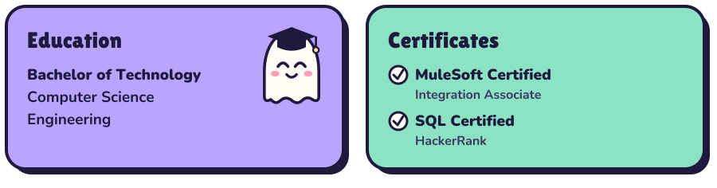
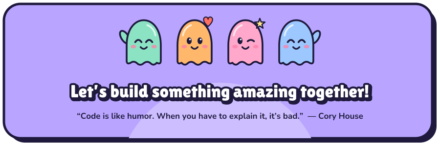

<!-- Generated file. Do not edit by hand. -->

 

  

  
  
  

  

 

<picture>
  <source media="(prefers-color-scheme: dark)" srcset="assets/title-about-dark.svg" />
  
</picture>

  I’m a Full Stack Developer from <b>Jaipur, India</b> with <b>3+ years</b> of experience building  scalable, secure web apps with the <b>MERN stack</b>, <b>TypeScript</b>, <b>PostgreSQL</b> and <b>AWS</b>.  I take products from architecture all the way to deployment.

  

  

 

<picture>
  <source media="(prefers-color-scheme: dark)" srcset="assets/title-stack-dark.svg" />
  
</picture>

  

 

<picture>
  <source media="(prefers-color-scheme: dark)" srcset="assets/title-experience-dark.svg" />
  
</picture>

 

<b>What I do at SoftSensor AI</b>

 

- Spearheaded optimizations of company products, enhancing performance and efficiency through effective code improvements.
- Developed and implemented new features and functionalities, significantly elevating user experience and product value.
- Deployed applications on AWS using CI/CD practices, ensuring smooth and reliable releases through automated processes.
- Utilized Docker for containerization, facilitating easier deployment and scalability of microservices-based solutions.
- Leveraged multiple databases including PostgreSQL, MongoDB, and MySQL for efficient data management and retrieval.
- Collaborated within a MERN stack environment, employing React.js and Node.js to deliver dynamic and responsive web applications.

 

 

<b>What I did at smartData Enterprises</b>

 

**Associate Software Developer II** · *Aug 2025 – Jun 2026*

- Lead end-to-end development of scalable web systems using MERN stack architecture
- Design and implement secure, modular RESTful APIs with comprehensive validation using Joi and Yup
- Develop real-time features using WebSocket for live notifications and seamless user interactions
- Collaborate with cross-functional teams including UI/UX designers, QA engineers, and product managers
- Optimize database queries and API endpoints for improved performance and scalability
- Implement security best practices including JWT authentication, data encryption, and role-based access control
- Deploy and maintain applications on AWS cloud infrastructure (EC2, S3, Textract, Lambda)
- Conduct code reviews and mentor junior developers on best practices

**Associate Software Developer I** · *Sep 2024 – Jul 2025*

- Developed and maintained full-stack web applications using React.js, Node.js, and Express.js
- Created responsive UI components using Material UI, Bootstrap, and custom CSS
- Integrated third-party APIs and services including payment gateways and notification systems
- Implemented state management using Redux for complex application workflows
- Wrote unit tests and integration tests to ensure code quality
- Participated in agile ceremonies including sprint planning, daily stand-ups, and retrospectives

**Associate Software Developer Intern** · *Oct 2023 – Aug 2024*

- Received comprehensive training in MERN stack technologies and best practices
- Collaborated with senior developers on multiple web application projects
- Contributed to frontend development using React.js and backend development using Node.js
- Participated in code reviews and learned industry-standard coding practices
- Assisted in debugging and fixing production issues
- Documented code and technical specifications

 

 

<b>What I did at Caelius Consulting</b>

 

- Developed and maintained enterprise APIs using MuleSoft platform
- Analyzed API performance metrics and identified optimization opportunities
- Supported complete API development lifecycle from requirements gathering to deployment
- Collaborated with clients to understand integration requirements
- Ensured seamless service delivery through proactive monitoring and issue resolution
- Documented API specifications and integration patterns

 

<picture>
  <source media="(prefers-color-scheme: dark)" srcset="assets/title-projects-dark.svg" />
  
</picture>

  

<b>Continuity Connect</b> · Care provider &amp; aged care management platform

 

> Unified digital platform supporting employee, contractor, and partnership-based care providers, enabling coordinated care delivery across organizations. Streamlines aged care services and home care packages with integrated care planning, documentation, compliance, scheduling, and collaboration tools.

- Developed frontend features using React.js and Tailwind CSS for responsive and modern user interfaces
- Implemented care planning, documentation, compliance, and scheduling modules using Node.js and TypeScript
- Built RESTful APIs with Express.js and Prisma ORM for efficient data management and query optimization
- Worked with PostgreSQL database for data storage, retrieval, and schema design
- Designed and implemented database schemas and optimized database queries for better performance
- Collaborated with team of 8-12 developers in agile environment, participating in sprint planning and daily stand-ups
- Implemented proper error handling and logging for all microservices

**Tech:** `React.js` `Node.js` `Express.js` `PostgreSQL` `Prisma ORM` `TypeScript` `Tailwind CSS` `Stripe` `Xero` `Telnyx` `LiveKit` `WebSockets` `Google Maps` `PRODA` `AWS (S3, Textract, Lambda, EC2)`

<b>Family Health Hub</b> · HIPAA-compliant healthcare platform

 

> HIPAA-compliant web-based healthcare platform designed to streamline appointment booking, role-based access control, and management of patients, healthcare professionals, and services.

- Architected and developed complete full-stack application from scratch
- Built appointment scheduling workflows with real-time availability checking
- Implemented role-based dashboards for healthcare professionals and business managers using JWT-based authentication
- Ensured HIPAA compliance through encryption of sensitive patient data at rest and in transit
- Designed and implemented modules for healthcare professional onboarding, service listings, and appointment management
- Developed SMTP-based email notification workflows for real-time updates and confirmations
- Deployed application on AWS EC2 with secure asset management on AWS S3
- Implemented comprehensive error handling and logging mechanisms

**Tech:** `React.js` `Node.js` `Express.js` `MySQL` `Material UI` `Bootstrap` `AWS EC2` `AWS S3` `JWT` `SMTP` `WebSocket`

<b>AiVisor</b> · Automotive service appointment scheduler

 

> End-to-end vehicle service appointment scheduling platform for car dealerships, enabling streamlined booking, updates, and cancellation through Xtime integration.

- Built dynamic appointment forms using React.js, Redux, and Yup with robust form validation
- Developed RESTful APIs with Node.js and Express for appointment CRUD operations
- Integrated Xtime APIs to fetch real-time customer, vehicle, appointment, and service data
- Applied Joi validation schemas for backend input validation on customer, vehicle, and services information
- Implemented responsive UI with real-time availability logic and enhanced user experience
- Created service recommendation engine based on vehicle history

**Tech:** `React.js` `Redux` `Node.js` `Express.js` `Yup` `Joi` `Xtime API Integration` `RESTful APIs`

<b>SafeSphere</b> · QHSE management solution

 

> PaaS-based QHSE (Quality, Health, Safety, and Environment) management solution aimed at enhancing safety performance and regulatory compliance for high-risk industries including Oil & Gas, Construction, and Manufacturing.

**Phase 1 (Feb 2024 – Aug 2024)**
- Implemented functionality for reporting Incident, Observation, and Safety Data Entry
- Developed comprehensive super admin section to manage organizational profiles, user configuration, locations, departments, clients, contractors, and risks
- Led API and frontend development while interacting with clients to align project with their needs
- Built analytics dashboard for report creation, management, and insights

**Phase 2 (Sep 2024 – Jan 2025)**
- Expanded reporting functionality to include Meeting reports, Management of Change (MoC) reports, and Risk Assessment reports
- Added investigation capabilities to Observation and Incident reports
- Enhanced super admin functionality for better user and organizational management
- Implemented advanced filtering and search capabilities

**Tech:** `React.js` `Node.js` `Express.js` `MongoDB` `RESTful APIs` `Bootstrap` `CSS3`

<b>IHG</b> · InterContinental Hotels Group

 

> Developed and maintained APIs for IHG utilizing MuleSoft technology to enhance scalability and guest experiences.

- Developed scalable APIs using MuleSoft platform
- Monitored API performance and ensured seamless service delivery
- Collaborated with stakeholders to understand business requirements
- Implemented error handling and logging mechanisms

**Tech:** `MuleSoft` `API Development` `Integration Services` `RESTful APIs`

 

<picture>
  <source media="(prefers-color-scheme: dark)" srcset="assets/title-stats-dark.svg" />
  
</picture>

  
  

  

 

<picture>
  <source media="(prefers-color-scheme: dark)" srcset="assets/title-learning-dark.svg" />
  
</picture>

  

 

<picture>
  <source media="(prefers-color-scheme: dark)" srcset="assets/title-links-dark.svg" />
  
</picture>

  
  
  
  
  
  

  
  
  

 

<picture>
  <source media="(prefers-color-scheme: dark)" srcset="assets/title-contact-dark.svg" />
  
</picture>

  

 

  

